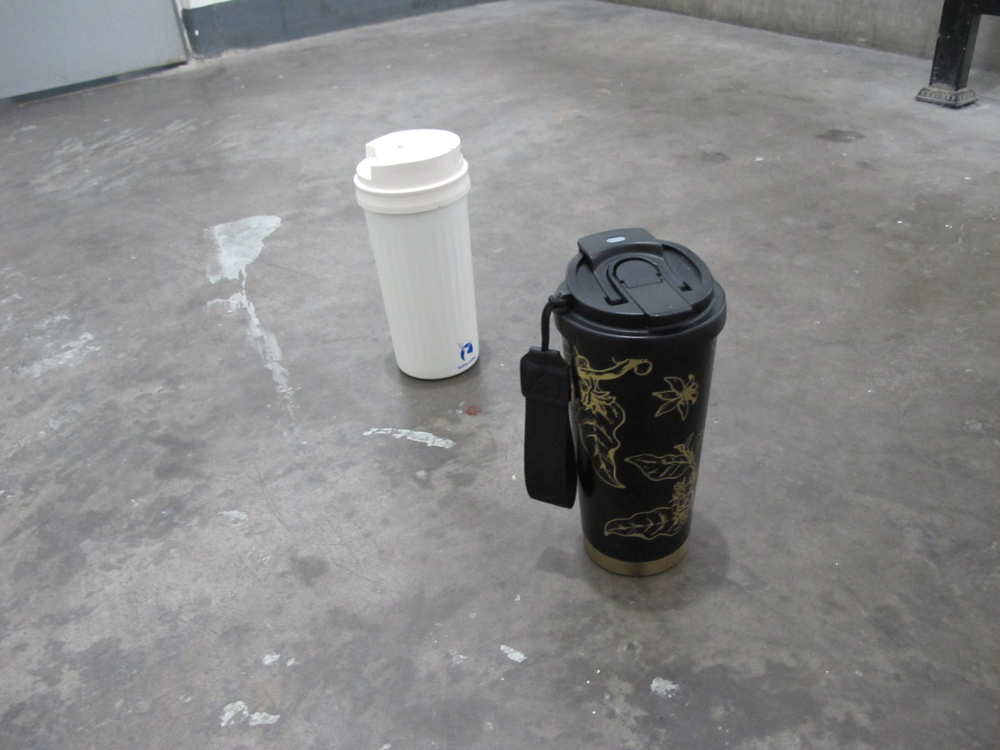
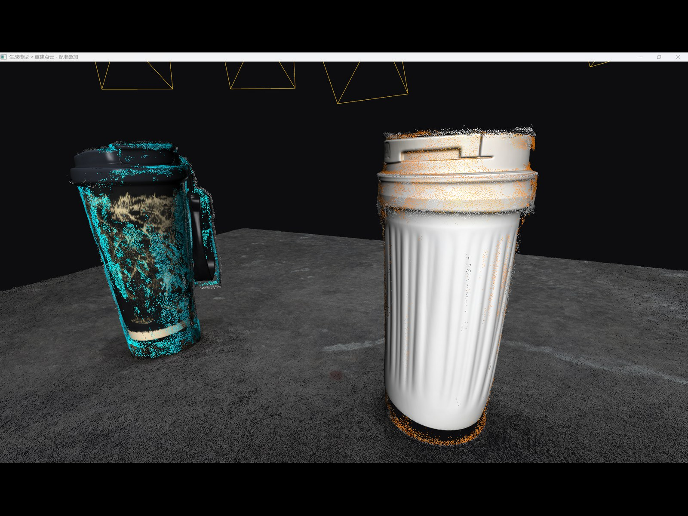
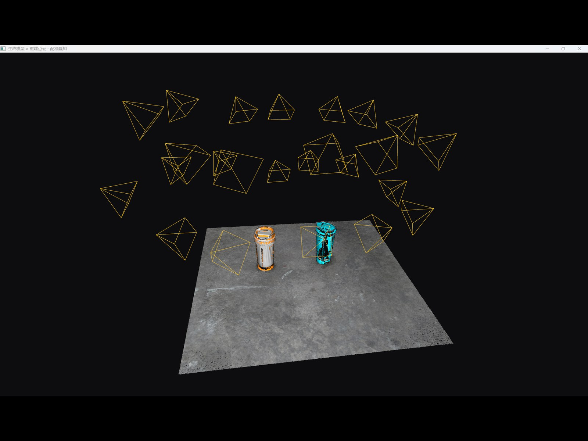
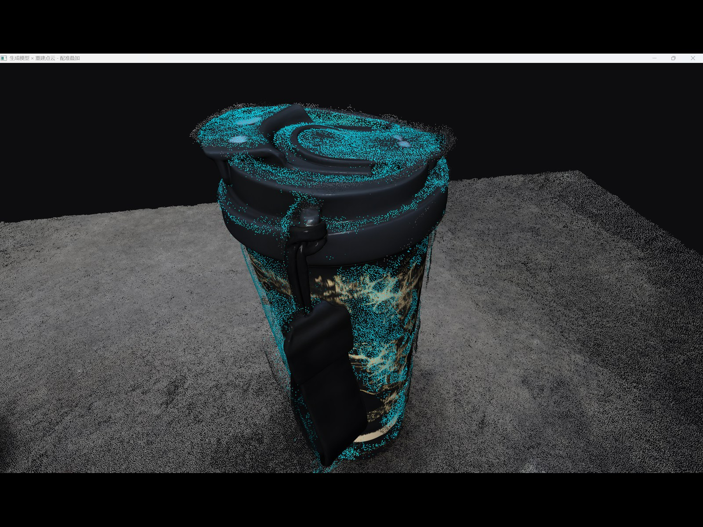

# 倾斜摄影三维重建 + 点云语义分割 + 图生 3D 配准

<p align="center">
  
  
</p>
<p align="center">
  输入：一组普通照片（黑杯 + 白杯） · 输出：点云 + 两个生成模型 + 相机位姿
  <br>
  <sub>青色 = 类别 1 的点云，橙色 = 类别 2 的点云，黄色四棱锥 = 拍摄时的相机位置</sub>
</p>

<p align="center">
  
  
</p>
<p align="center">
  相机位姿：每张照片一个四棱锥 · 黑杯分割特写
</p>

从一组照片出发：

```
照片
 │ COLMAP 特征 → 匹配 → SfM → 去畸变
 ▼
去畸变图 + 相机位姿
 │ OpenMVS 稠密点云 / 网格
 ▼
重建点云
 │ SAM 3 多提示词分割（一个概念 = 一个类别 id）
 ▼
点云类别标签 ──┬── 每个物体白底抠图
               │       │ 按相机位姿自动选 front/left/right/back
               │       ▼
               │   混元多视角图生 3D
               │       │
               └───────┴──► 多物体配准 → Open3D 叠加显示（含相机位置）
```

实测环境：Windows 11 + PowerShell；COLMAP / OpenMVS 走 CPU；SAM 3 单独一个 conda 环境，走 CUDA。

> `food` 是食品学院的楼，不是食物。这个场景用来演示窗户、植物、空调外机等建筑构件。

---

## 目录结构

```
data\<场景>\                 原始照片
work\<场景>\                 COLMAP / OpenMVS 工作目录（中间产物，不入库）
  dense\images\              去畸变图 ← SAM 3 的输入
  dense\sparse\              相机内参 + 位姿 ← mask_to_points / colmap_views 的输入
  mvs\scene_dense.ply        稠密点云
  mvs\scene_dense_mesh.ply   网格（遮挡剔除用）
work\img2_3d\<JobId>\        混元图生 3D 的结果（已 gitignore）
masks_<场景>\                SAM 3 索引 mask（可重建，不入库）
out\                         抠图、选视角、标签、配准结果（可重建，不入库）
demo_pic\                    README 效果图
tools\                       重建、分割、抠图、图生 3D、配准工具
docs\                        详细手册
```

仓库发布代码、文档和少量示例数据；`work/img2_3d/`、`out/`、`masks_*` 都能重新生成。

---

## 环境

| 用途 | 环境 / 路径 | 关键依赖 |
|---|---|---|
| 重建 | `tools\colmap\colmap.exe`、`OpenMVS_Windows_x64\` | COLMAP 4.2、OpenMVS v2.4.0（CPU） |
| 投影与点云 | `basic_env`（conda） | numpy、open3d、trimesh、Pillow |
| SAM 3 | `sam3`（conda，独立另建） | torch cu128、ultralytics、GPU |

```powershell
$root = "D:\code\point_cloud\0916"
$py   = "C:\Users\FANLS\.conda\envs\basic_env\python.exe"
$sam  = "D:\ProgramData\anaconda3\envs\sam3\python.exe"
```

两个 Python 环境靠 PNG 文件交接：`sam3` 出 mask，`basic_env` 读 mask 投点云。没有任何单个进程能跨这两个环境。

安装、SAM 3 环境和权重下载见 [docs/OpenMVS操作手册.md](docs/OpenMVS操作手册.md)、[docs/SAM3生成mask.md](docs/SAM3生成mask.md)。

---

## 全流程（推荐先看）

从照片一路做到「生成模型配准回点云」的完整命令、参数和踩坑都在
**[docs/全流程.md](docs/全流程.md)**。它覆盖：

- 一次定义场景变量（`$root` / `$objs` / `$scene` / `$W` / `$cutouts`）；
- **多物体**：`$objs = @("black cup", "white cup")`，分割、抠图、选视角、提交 API、配准全部按类别 id 一一对应；
- **自动选视角**：同时考虑方位角和目标在画面里的大小/完整性；
- **相机位姿显示**：窗口里用黄色四棱锥画出每张照片的位置；
- 每步的产物、可调参数和常见报错。

不想手工逐条跑重建，可以先用脚本完成 COLMAP + OpenMVS：

```powershell
bash ./run_pipeline.sh data/<场景> <场景>
```

产物在 `work\<场景>\`，之后从全流程文档第 4 节接 SAM 3。脚本默认放宽了 COLMAP 注册阈值
（`COLMAP_RELAXED=0` 可恢复官方值），并会自动选用注册图像最多的子模型。

---

## 快速开始：只做点云语义分割

下面以 `food` 场景为例。需要图生 3D / 配准 / 相机显示时，直接走全流程文档。

### 0. 变量

```powershell
$scene = "food"
$W     = "$root\work\$scene"
$IMG   = "$root\data\$scene"
$mvs   = "$root\OpenMVS_Windows_x64\vc17\x64\Release"

New-Item -ItemType Directory -Force "$W\sparse","$W\dense","$W\mvs" | Out-Null
```

### 1. COLMAP：特征 → 匹配 → SfM → 去畸变

```powershell
$colmap = "$root\tools\colmap\colmap.exe"

& $colmap feature_extractor `
  --database_path "$W\db.db" --image_path $IMG `
  --ImageReader.single_camera 1 `
  --FeatureExtraction.use_gpu 0 `
  --FeatureExtraction.max_image_size 2000 `
  --SiftExtraction.max_num_features 16384 `
  --SiftExtraction.peak_threshold 0.004

& $colmap exhaustive_matcher --database_path "$W\db.db" `
  --FeatureMatching.use_gpu 0 `
  --SiftMatching.max_ratio 0.85 --SiftMatching.max_distance 0.8 `
  --TwoViewGeometry.min_num_inliers 8

& $colmap mapper `
  --database_path "$W\db.db" --image_path $IMG --output_path "$W\sparse" `
  --Mapper.init_min_num_inliers 50 `
  --Mapper.abs_pose_min_num_inliers 15 `
  --Mapper.abs_pose_min_inlier_ratio 0.15 `
  --Mapper.filter_max_reproj_error 6 `
  --Mapper.tri_min_angle 0.5

& $colmap image_undistorter `
  --image_path $IMG --input_path "$W\sparse\0" `
  --output_path "$W\dense" --output_type COLMAP
```

- 上面的注册阈值比 COLMAP 官方默认宽松，弱纹理物体能多注册几张；如果模型明显歪了，把
  `filter_max_reproj_error` 调回 4、`tri_min_angle` 调回 1.5。
- 如果 `sparse\` 下出现 `0`、`1`、`2` 多个目录，用注册图像最多的那个替换
  `--input_path "$W\sparse\0"`。
- `image_undistorter` 会改变图像尺寸（food：3648×2736 → 3781×2788）。后面的 mask、投影、SAM 3
  都必须用 `work\<场景>\dense\images\`，不能用原图目录。

### 2. OpenMVS：稠密点云 → 网格 → 贴图

```powershell
& "$mvs\InterfaceCOLMAP.exe" `
  -i "$W\dense" -o "$W\mvs\scene.mvs" `
  --image-folder "$W\dense\images" -w "$W\mvs"

Push-Location "$W\mvs"

& "$mvs\DensifyPointCloud.exe" scene.mvs `
  --resolution-level 1 --max-resolution 2000 --number-views 8 --max-threads 0

& "$mvs\ReconstructMesh.exe" scene_dense.mvs `
  -p scene_dense.ply -o scene_dense_mesh.ply

& "$mvs\TextureMesh.exe" scene_dense.mvs `
  -m scene_dense_mesh.ply -o scene_textured.ply `
  --global-seam-leveling 0 --local-seam-leveling 0

Pop-Location
```

注意 `ReconstructMesh` 的 `-p` 是**输入稠密点云**，`-o` 才是输出网格。

### 3. SAM 3 生成 mask

SAM 3 一次可以给多个概念：**顺序就是类别 id 的顺序**。`--text` 可以重复写，也可以用逗号分隔。

```powershell
$mask = "$root\masks_$scene"

# 自检：不加载模型，验证索引图不变量
& $sam "$root\tools\sam3_masks.py" --selftest

# 单张先看叠加图（确认概念选得对不对）
& $sam "$root\tools\sam3_masks.py" `
  --images "$W\dense\images" --out $mask `
  --text "window,plant,airconditioner" --overwrite `
  --expect-size 3781 2788 --limit 1 `
  --overlay-dir "$root\out\sam_overlay_$scene"

# 批量
& $sam "$root\tools\sam3_masks.py" `
  --images "$W\dense\images" --out $mask `
  --text "window,plant,airconditioner" `
  --expect-size 3781 2788 `
  --overlay-dir "$root\out\sam_overlay_$scene"
```

- 默认**只写 mask，不写叠加图**；需要肉眼验收时显式加 `--overlay-dir`。
- `--expect-size` 会硬校验去畸变图尺寸，防止误把原图目录传进来。
- 默认跳过已有 mask；**改了提示词或类别数后要加 `--overwrite`**。
- 输出是单通道 uint8 索引图：`0` = 背景，`1/2/3` = 第 1/2/3 个概念。

### 4. mask 回灌点云

```powershell
& $py "$root\tools\mask_to_points.py" `
  --scene "$W\dense\sparse" `
  --mask-dir $mask --mask-mode index `
  --class-names "window,plant,airconditioner" --min-conf 0.9 `
  --out "$root\out\${scene}_masked.ply" `
  --out-all "$root\out\${scene}_all_labeled.ply" `
  --labels "$root\out\${scene}_labels.npy" `
  --save-npz "$root\out\${scene}_full.npz" `
  --save-json "$root\out\${scene}_stats.json"
```

`--class-names` 的顺序必须和 `--text` 一致。`--min-conf 0.9` 压掉跨视角并集噪声；
不要用 `--min-votes` 代替，它会误杀只有少数视角看得见的正确点。

### 5. 一条命令看 3D

```powershell
& $py "$root\tools\seg_vis.py" `
  --scene food `
  --text window --text plant --text airconditioner
```

它会自动检查 mask、做多视角投票和遮挡剔除，然后弹出带类别颜色的 Open3D 窗口。
需要保存 2D 叠加图时加 `--overlay`。

---

## 图生 3D 与配准（可选）

每个物体单独走一遍：

```powershell
# 1) 按相机位姿选 front/left/right/back
& $py "$root\tools\colmap_views.py" `
  --model "$W\dense\sparse" --class-id 1 --cutouts "$root\out\${scene}_cutouts_$obj" `
  --out "$root\out\${scene}_views_$obj.json"

# 2) 先 dry-run，不花钱
& $py "$root\tools\img_to_3d.py" `
  --pro --colmap-model "$W\dense\sparse" --dry-run `
  --class-id 1 --cutouts "$root\out\${scene}_cutouts_$obj" `
  --views-json "$root\out\${scene}_views_$obj.json"

# 3) 确认预览图后提交（会扣积分）
& $py "$root\tools\img_to_3d.py" `
  --pro --model-version 3.0 --colmap-model "$W\dense\sparse" `
  --class-id 1 --cutouts "$root\out\${scene}_cutouts_$obj" `
  --views-json "$root\out\${scene}_views_$obj.json"
```

多物体配准（类别 id 必须和 SAM 3 的顺序一致）：

```powershell
& $py "$root\tools\register_model_to_cloud.py" `
  --cloud "$W\mvs\scene_dense.ply" `
  --labels "$root\out\${scene}_labels.npy" `
  --npz "$root\out\${scene}_full.npz" `
  --mesh "1=$root\work\img2_3d\<JobId1>\obj1.glb" `
  --mesh "2=$root\work\img2_3d\<JobId2>\obj2.glb" `
  --mode object --up-axis auto `
  --colmap-model "$W\dense\sparse" `
  --out-merged "$root\out\${scene}_registered.ply" `
  --save-transform "$root\out\${scene}_registration.json"
```

`--colmap-model` 会读 `images.bin`，在窗口里给每张照片画一个黄色四棱锥；
不想要加 `--no-cameras`。建筑用默认 `--mode facade`，桌面独立物体加
`--mode object --up-axis auto`。

原理、参数和实测数据见 [docs/模型与点云配准.md](docs/模型与点云配准.md)、
[docs/图生3D.md](docs/图生3D.md)。

---

## 分割约定

- **一个概念 = 一个类别 id**。同类多个实例取并集，不区分单个窗户。
- **概念顺序必须跨工具一致**：`sam3_masks.py --text`、`mask_to_points.py --class-names`、
  `colmap_views.py --class-id`、`register_model_to_cloud.py --mesh` 四处要相同。
- **mask 必须来自去畸变图**：原图和去畸变图尺寸、畸变都不同，混用会整体错位。
- **背景默认不投票**；一个点只有在多数可见视角中落在同一类别，才会被采纳。
- 多概念重叠时由 `--priority first` 决定：先列出的概念优先，建议按「具体 → 宽泛」排列。
- 标签不写进 PLY 顶点属性，而是单独存 `labels.npy`；它和输入点云**同序**，不要对点云做裁剪、
  排序或去重。

### 常用参数

| 参数 | 作用 | 建议 |
|---|---|---|
| `--min-conf 0.9` | 一致比例 `n_vote / n_visible` 下限 | 压 mask 边界噪声，通常 0.9 |
| `--min-votes N` | 至少 N 个视角投同一类 | 少用，容易误杀劣视角真标签 |
| `--min-visible N` | 至少被 N 个视角看到 | 默认 1 |
| `--depth-tol` | 遮挡容差 | 默认自适应；调试时加 `--depth-tol-hist` 看分布 |
| `--conf` | SAM 3 置信度阈值 | 默认 0.25，漏检多就调低 |
| `--imgsz` | SAM 3 推理分辨率 | 默认 1008，显存不够调小 |
| `--priority first/last` | 多概念重叠归谁 | 默认 `first` |

---

## 产物与清理

| 路径 | 内容 | 能否删除 |
|---|---|---|
| `work\<场景>\` | COLMAP / OpenMVS 中间产物 | 能，重跑整条重建 |
| `work\<场景>\dense\images\` | 去畸变图，SAM 3 的输入 | 能，重跑 `image_undistorter` |
| `masks_<场景>\` | 索引 mask | 能，重跑 `sam3_masks.py` |
| `out\<场景>_*` | 抠图、选视角、标签、配准结果 | 能，重跑对应步骤 |
| `work\img2_3d\<JobId>\` | 混元生成的 3D 模型 | **能，但重新生成会再扣积分** |

只清当前场景的中间产物（保留 `data\` 原图和已生成的 3D 模型）：

```powershell
$root  = "D:\code\point_cloud\0916"
$scene = "cup2"

# SAM3 + 下游
Remove-Item -Recurse -Force "$root\masks_$scene" -ErrorAction SilentlyContinue
Remove-Item -Recurse -Force "$root\out\sam_overlay_$scene" -ErrorAction SilentlyContinue
Get-ChildItem "$root\out" -Filter "${scene}_*" -ErrorAction SilentlyContinue |
    Remove-Item -Recurse -Force

# 连 COLMAP / OpenMVS 重建一起清（约 1.6 GB）
Remove-Item -Recurse -Force "$root\work\$scene" -ErrorAction SilentlyContinue
```

不要删 `work\img2_3d\`，除非确定不要已生成的模型。

---

## 已知限制

- **SAM 3 的文本编码器是英文 CLIP**：中文提示基本无效，请用英文概念；`black cup` 这类带空格的
  短语比 `blackcup` 更稳。
- **细粒度结构词不可靠**：`crevice`、`crack`、`joint` 这类岩缝/节理提示词实测几乎检不出；
  `rock` 会返回整面岩壁。需要岩缝时得另做 2D 黑帽/脊线或点云几何凹陷检测。
- **OpenMVS 的 CUDA 预编译包只编了 sm_89**，RTX 5070 Ti（sm_120）加载会失败，所以重建走 CPU。
- **单航带直线飞行会失败**：相机中心共线，无法约束滚转角。需要往复式航线、环绕拍摄或高度变化。
- **COLMAP 放宽阈值有代价**：注册图像更多，但位姿精度会略降；模型明显歪时把
  `Mapper.filter_max_reproj_error` 和 `Mapper.tri_min_angle` 调回官方值。

---

## 相关文档

| 文件 | 内容 |
|---|---|
| **[docs/全流程.md](docs/全流程.md)** | **推荐入口**：照片 → 重建 → 多物体分割 → 图生 3D → 配准 → 相机显示的完整命令 |
| [docs/food完整流程.md](docs/food完整流程.md) | 从照片到带纹理模型的逐条实测流程与参数 |
| [docs/SAM3生成mask.md](docs/SAM3生成mask.md) | SAM 3 环境、权重、mask 生成与排错 |
| [docs/mask点云分割.md](docs/mask点云分割.md) | 多视角投票、遮挡剔除、参数与实测分布 |
| [docs/模型与点云配准.md](docs/模型与点云配准.md) | 生成模型与重建点云的配准原理、参数和坑 |
| [docs/图生3D.md](docs/图生3D.md) | 混元生 3D 接口、多视角提交和 Open3D 显示 |
| [docs/换标注概念.md](docs/换标注概念.md) | 换概念时的检查清单 |
| [docs/2D框投影到3D模型.md](docs/2D框投影到3D模型.md) | 2D 框 → 3D 网格碎片的另一条链路 |
| [docs/OpenMVS操作手册.md](docs/OpenMVS操作手册.md) | OpenMVS 通用操作与安装 |
| [docs/流程与产物.md](docs/流程与产物.md) | 全仓库流程与产物对照表 |
